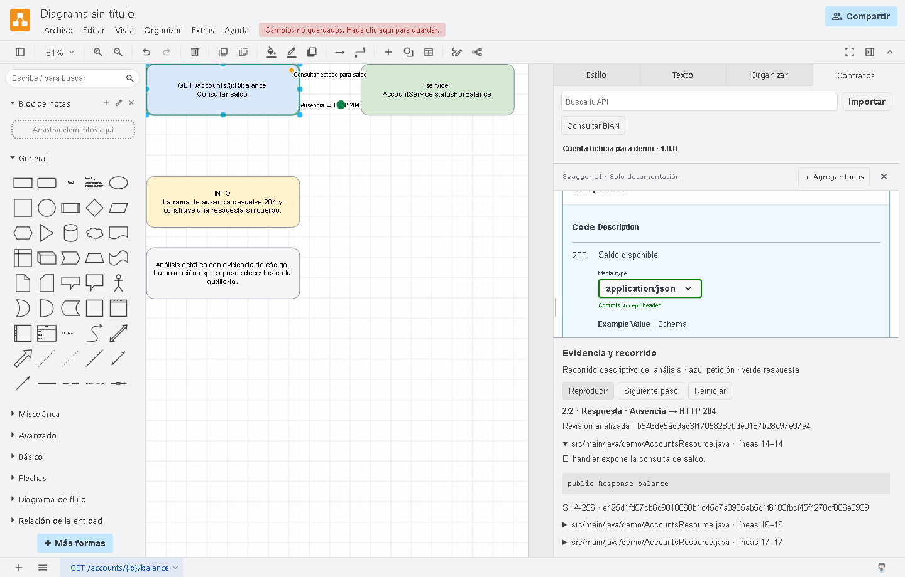

# Backend Copilot con auditoría visual

`backend-java` coordina cambios, revisiones y auditorías de microservicios Java desde Copilot. Delega en especialistas de contrato, implementación y pruebas, y pide una revisión independiente antes de entregar.

## De la petición a la entrega

> Agrega `GET /accounts/{id}/status`. Devuelve `200` con `{"active":true}` para la cuenta `demo` y `404` para otras cuentas. Actualiza OpenAPI, prueba ambos casos y pasa el cambio al revisor.

El agente estudia el servicio, presenta el plan, actualiza el contrato, implementa el endpoint y ejecuta las validaciones aplicables. El revisor contrasta el diff con el contrato y los reportes. Al final recibes el resultado y la propuesta de commits para aprobar. [Ver el flujo completo y los demás ejemplos](examples/README.md)

Si también pides una vista visual, puedes abrir el endpoint con su contrato, las citas del código y el recorrido. Esta captura muestra la respuesta `204` durante la reproducción del endpoint de saldo de la demo.



## Componentes

| Componente | Función |
| --- | --- |
| `agents/` | Orquestador, especialistas y revisor |
| `skills/` | Las 15 capacidades backend originales y las capacidades de auditoría visual |
| `src/` | Descubrimiento, verificación de evidencias y generación de archivos Draw.io |
| `editor/` | Fork de Draw.io con Swagger, evidencia y reproducción de flujos |
| `examples/` | Servicio ficticio y entrada reproducible para la demo |

## Usarlo desde Copilot

El editor fijado requiere Node **24.18.x** y npm **11.16.x**. Para preparar y abrir la demo desde PowerShell ejecuta lo siguiente.

```powershell
git clone https://github.com/DiegoAlosilla/backend-java-hackathon.git
cd backend-java-hackathon
npm ci
npm --prefix editor ci
npm --prefix editor run build
npm run editor
```

Con el editor abierto, ejecuta en otra terminal lo siguiente.

```powershell
npm run demo -- --open
```

El primer arranque descarga y verifica Draw.io 32.4.1. El ejemplo genera `runs/demo/account.drawio` y `runs/demo/audit.json`. Selecciona el endpoint para consultar su contrato y usa **Reproducir** en **Evidencia y recorrido**.

[Ejemplos de uso para las 17 habilidades](examples/README.md) · [Diagrama de ejemplo editable](editor/docs/evidence/audit-portable.drawio)

Instala el plugin local siguiendo [la guía de Copilot](docs/copilot.md) y abre el microservicio sobre el que trabajarás. Selecciona `backend-java`.

## Auditoría y editor

Los comandos y el formato de entrada están en [la guía del pipeline](docs/audit.md). El arranque, los controles de reproducción y las pruebas de compatibilidad están en [la guía del editor](docs/editor.md).

Cada archivo `.drawio` contiene figuras y conexiones nativas editables. Los contratos y las evidencias se guardan dentro del documento, de modo que compartirlo también comparte esos extractos. El fork interpreta los metadatos para mostrar Swagger, evidencia y reproducción. La animación representa el recorrido documentado a partir del análisis del código.

## Procedencia

La base de agentes, skills y verificación proviene de Backend Copilot Agent. El descubrimiento y la entrega local reutilizan ArchiFlowAgent. El editor se deriva de Draw.io Contracts Local. ArchiFlow sirvió de referencia para el recorrido visual. Las dependencias y el editor Draw.io conservan sus avisos en [THIRD_PARTY_NOTICES.md](editor/THIRD_PARTY_NOTICES.md) y [`editor/licenses/`](editor/licenses/).

Esta integración es un MVP propio. La cobertura del descubrimiento, las verificaciones ejecutadas y las limitaciones comprobadas se detallan en las guías de cada componente.
