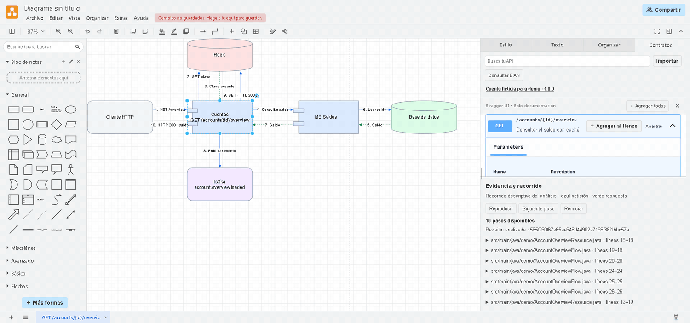

# Backend Copilot con auditoría visual

`backend-java` coordina cambios, revisiones y auditorías de microservicios Java desde Copilot. Delega en especialistas de contrato, implementación y pruebas, y pide una revisión independiente antes de entregar.

## Demo del agente auditor

> Audita este microservicio. Muéstrame los endpoints, el recorrido hacia Redis, la base de datos y el tópico, y las citas del código en un diagrama de componentes.

El GIF muestra el formato del auditor. En el ejemplo de saldo, Cuentas lee Redis, solicita el dato a otro microservicio, publica en Kafka y actualiza la caché antes de devolver `200`. [Ver el flujo y descargar el diagrama](examples/README.md#recorrido-por-redis-saldos-bd-y-kafka)



Para una demo de principio a fin, levanta el **CRUD de cuentas**. Audita el registro y el listado existentes, pide implementar `DELETE`, ejecuta las pruebas y vuelve a diagramar el endpoint nuevo. Usa Quarkus y adaptadores locales en memoria para Redis, BD y Kafka. [Guion de la demo CRUD](examples/accounts-crud/README.md)

## Cómo trabaja el agente al agregar un endpoint

Si le pides **«Agrega un nuevo endpoint a este microservicio»**, `backend-java` coordina este flujo.

> En el CRUD de cuentas, agrega `DELETE /accounts/{id}`. Si la cuenta existe, elimínala de la base de datos, borra su clave de Redis si está presente, invalida la lista cacheada y publica `accounts.deleted`. Devuelve `204` sin cuerpo. Si la cuenta no existe, devuelve `404` sin publicar el evento. Actualiza OpenAPI, ejecuta las pruebas y pasa el cambio al revisor.

1. **Entiende el servicio.** Localiza los endpoints existentes, el contrato OpenAPI, las capas Java y las convenciones del proyecto. Si falta una decisión que cambia el comportamiento, como qué devolver cuando el recurso no existe, te la consulta.
2. **Presenta el plan.** Define método, ruta, entradas, respuestas, archivos afectados y criterios de aceptación. Te muestra el plan antes de editar y avanza con el cambio solicitado.
3. **Actualiza el contrato.** Añade la operación en la fuente OpenAPI del servicio. Si el proyecto genera interfaces o modelos desde el contrato, usa su proceso de generación.
4. **Implementa el endpoint.** Añade el handler y la lógica de negocio siguiendo los patrones del servicio. Si hacen falta cambios de configuración por ambiente, te entrega el delta.
5. **Prueba y valida.** Añade pruebas unitarias y usa Karate cuando corresponda. Ejecuta el build y los controles de calidad aplicables, como Checkstyle y JaCoCo, y relaciona cada criterio de aceptación con sus resultados.
6. **Pasa el cambio a revisión independiente.** El revisor contrasta el diff, el contrato y los reportes. Si encuentra un problema, el orquestador delega la corrección y repite las validaciones afectadas.
7. **Entrega el resultado.** Resume qué cambió, qué pasó y qué quedó pendiente. Propone la agrupación de commits y espera tu aprobación antes de crearlos.

**Si también pides el diagrama**, el auditor toma el código final y abre el endpoint en tu fork de Draw.io con su contrato Swagger, citas del código y el recorrido animado.

## Componentes

| Componente | Función |
| --- | --- |
| `agents/` | Orquestador, especialistas y revisor |
| `skills/` | Las 15 capacidades backend originales y las capacidades de auditoría visual |
| `src/` | Descubrimiento, verificación de evidencias y generación de archivos Draw.io |
| `editor/` | Fork de Draw.io con Swagger, evidencia y reproducción de flujos |
| `examples/` | Servicio ficticio y entrada reproducible para la demo |

## Usarlo desde Copilot

El editor fijado requiere Node **24.18.x** y npm **11.16.x**. Para preparar y abrir la demo desde PowerShell ejecuta lo siguiente.

```powershell
git clone https://github.com/DiegoAlosilla/backend-java-hackathon.git
cd backend-java-hackathon
npm ci
npm --prefix editor ci
npm --prefix editor run build
npm run editor
```

Con el editor abierto, ejecuta en otra terminal lo siguiente.

```powershell
node src/cli.mjs demo-overview --open
```

El primer arranque descarga y verifica Draw.io 32.4.1. El ejemplo genera `runs/overview/overview.drawio` y `runs/overview/audit.json`. Selecciona el endpoint para consultar su contrato y usa **Reproducir** en **Evidencia y recorrido**.

[Ejemplos de uso para las 17 habilidades](examples/README.md) · [Diagrama de componentes editable](examples/overview/overview.drawio)

Instala el plugin local siguiendo [la guía de Copilot](docs/copilot.md) y abre el microservicio sobre el que trabajarás. Selecciona `backend-java`.

## Auditoría y editor

Los comandos y el formato de entrada están en [la guía del pipeline](docs/audit.md). El arranque, los controles de reproducción y las pruebas de compatibilidad están en [la guía del editor](docs/editor.md).

Cada archivo `.drawio` contiene figuras y conexiones nativas editables. Los contratos y las evidencias se guardan dentro del documento, de modo que compartirlo también comparte esos extractos. El fork interpreta los metadatos para mostrar Swagger, evidencia y reproducción. La animación representa el recorrido documentado a partir del análisis del código.

## Procedencia

La base de agentes, skills y verificación proviene de Backend Copilot Agent. El descubrimiento y la entrega local reutilizan ArchiFlowAgent. El editor se deriva de Draw.io Contracts Local. ArchiFlow sirvió de referencia para el recorrido visual. Las dependencias y el editor Draw.io conservan sus avisos en [THIRD_PARTY_NOTICES.md](editor/THIRD_PARTY_NOTICES.md) y [`editor/licenses/`](editor/licenses/).

Esta integración es un MVP propio. La cobertura del descubrimiento, las verificaciones ejecutadas y las limitaciones comprobadas se detallan en las guías de cada componente.
