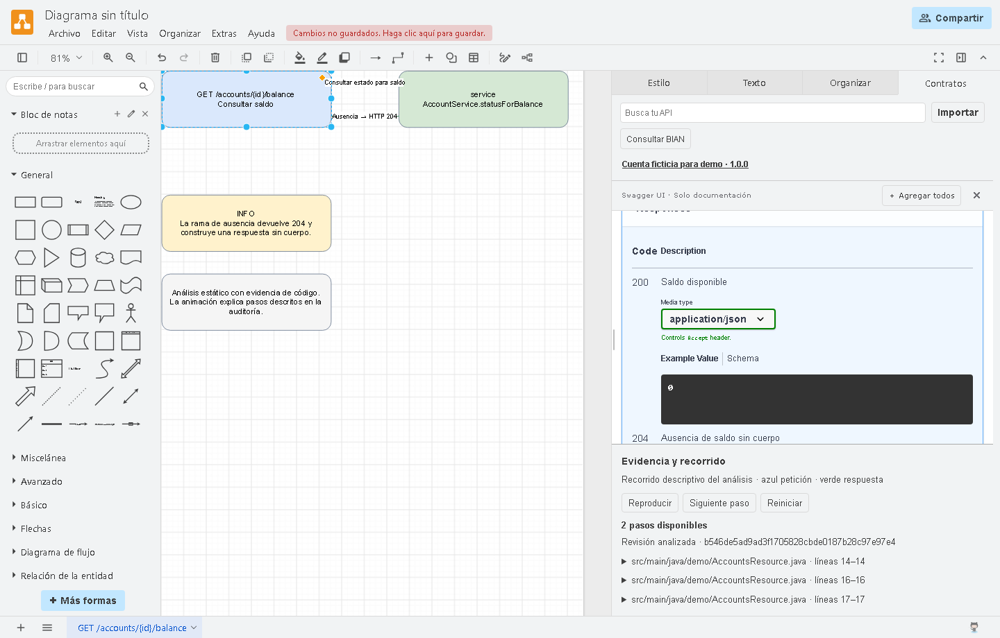
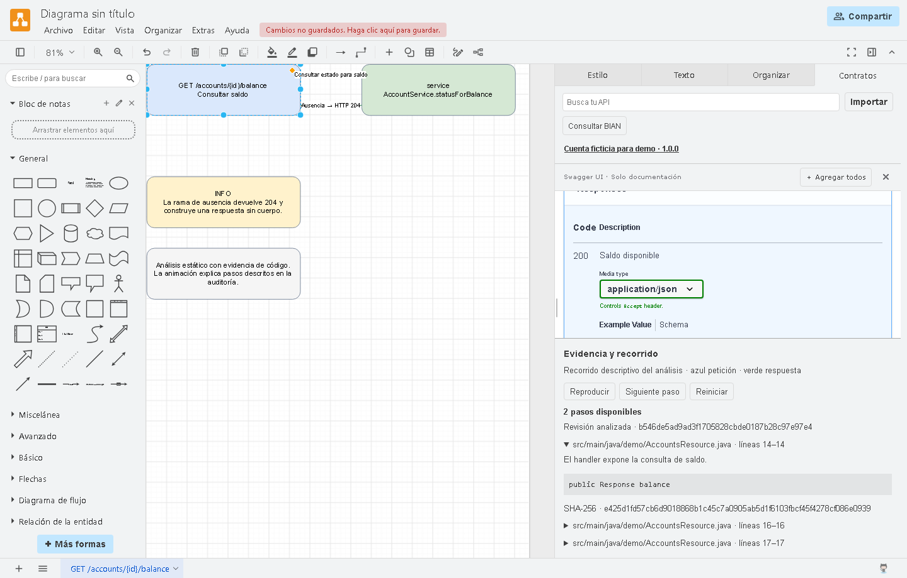
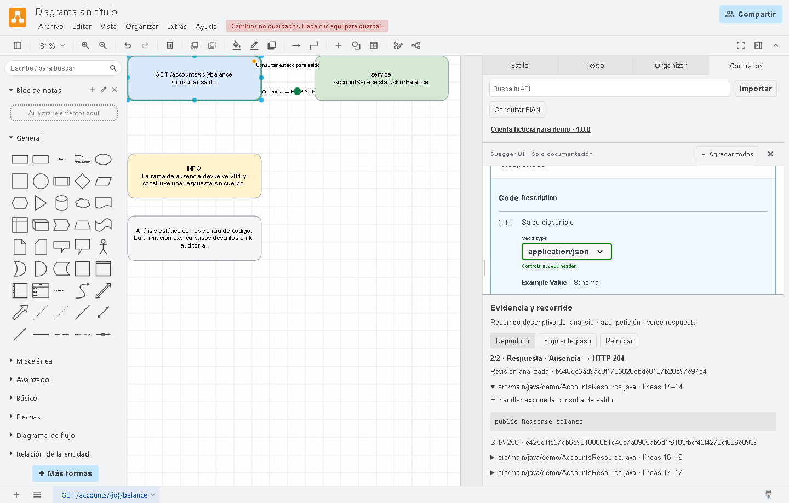
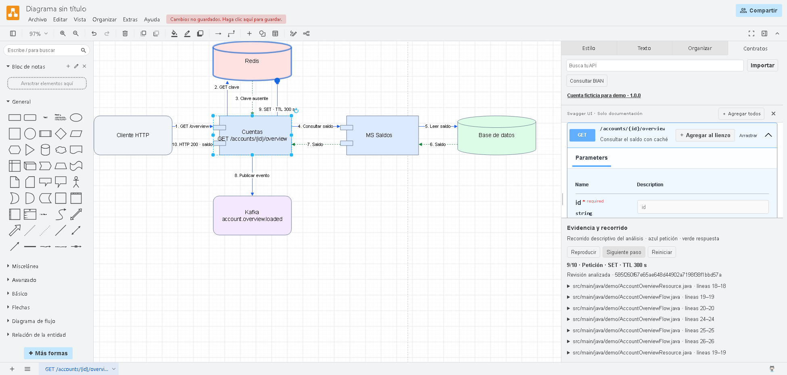

# Ejemplos de uso

Instala el plugin desde el clon y selecciona `backend-java` en Copilot. Usa el [servicio ficticio de cuentas](account-service/) para practicar. La [guía de instalación](../docs/copilot.md) describe cómo habilitar el plugin y comprobar la delegación.

[Agregar un endpoint](#agregar-un-endpoint) · [Revisar un cambio](#revisar-un-cambio) · [Auditar un endpoint](#auditar-un-endpoint) · [Recorrido de componentes](#recorrido-por-redis-saldos-bd-y-kafka) · [Pedidos por habilidad](#pedidos-por-habilidad)

## Demo reproducible

Desde la raíz del repositorio, instala las dependencias y genera el diagrama.

```powershell
npm ci
npm --prefix editor ci
npm --prefix editor run build
npm run demo
```

Abre `runs/demo/account.drawio` en Draw.io. Para ver Swagger, las citas y la animación, inicia `npm run editor` y ejecuta `npm run demo -- --open` en otra terminal. Selecciona `GET /accounts/{id}/balance` y pulsa **Reproducir**. También puedes abrir la [copia portable](../editor/docs/evidence/audit-portable.drawio) o importar los [contratos ficticios](../editor/examples/contracts/).

Las pruebas unitarias del servicio ficticio se ejecutan con `mvn -f examples/account-service/pom.xml test` usando JDK 17. Los ejemplos de Kafka, Karate, configuración y sanity requieren un servicio o entorno que tenga esas capacidades.

## Agregar un endpoint

> En el servicio ficticio de cuentas, agrega `GET /accounts/{id}/status`. Devuelve `200` con `{"active":true}` para la cuenta `demo` y `404` para otras cuentas. Muéstrame el plan, añade la operación en OpenAPI, implementa el cambio y prueba ambos casos. Pasa el diff y los resultados al revisor. Abre el endpoint en Draw.io con el contrato, las citas y el recorrido. Propón los commits al final.

1. **Entiende el servicio.** Localiza las operaciones existentes, el contrato OpenAPI y las capas Java. Si falta una decisión que afecta el comportamiento, como la respuesta para una cuenta desconocida, te la consulta.
2. **Presenta el plan.** Define el método, la ruta, las respuestas, los archivos afectados y los criterios de aceptación. Te muestra el plan antes de editar.
3. **Actualiza el contrato.** Añade la operación en el OpenAPI del servicio. Si el proyecto genera interfaces o modelos, usa su proceso de generación.
4. **Implementa el endpoint.** Añade el handler y la lógica siguiendo los patrones del servicio. Si hay cambios de configuración por ambiente, te entrega el delta.
5. **Prueba y valida.** Añade regresiones para `200` y `404`. Ejecuta el build y los controles aplicables, como Karate, Checkstyle o JaCoCo. Relaciona los criterios de aceptación con los resultados.
6. **Pasa el cambio a revisión independiente.** El revisor contrasta el diff, el contrato y los reportes. Si encuentra un problema, el orquestador delega la corrección y repite las validaciones afectadas.
7. **Entrega el resultado.** Resume los cambios, las pruebas y los pendientes. Propone una agrupación de commits y espera tu aprobación antes de crearlos.

**Si también pides el diagrama**, el auditor analiza el código final validado y el especialista en diagramación abre el endpoint en tu fork de Draw.io con Swagger, citas del código y el recorrido animado. [Ver cómo se presenta en la demo de saldo](#auditar-un-endpoint)

## Revisar un cambio

> Revisa el diff local respecto a `HEAD`. Si afecta la consulta de saldo, comprueba que el caso sin saldo siga devolviendo `204` sin cuerpo. Contrasta el código, OpenAPI y las pruebas. Pide al revisor que valide los hallazgos y dime qué quedaría pendiente antes del merge.

1. **Delimita el diff.** Toma `HEAD` como base, ubica los archivos modificados y determina qué endpoints pueden verse afectados.
2. **Contrasta las fuentes.** Compara los cambios de Java con el contrato y las pruebas. Comprueba si hay evidencia del `204` sin cuerpo y señala cualquier validación que falte.
3. **Solicita una revisión independiente.** El revisor examina el diff y comprueba que las fuentes y reportes vigentes respalden cada hallazgo.
4. **Entrega los hallazgos.** Indica su ubicación, impacto, evidencia y verificaciones pendientes. Si le pides una corrección, coordina la implementación y vuelve a validar.

## Auditar un endpoint

> Audita `GET /accounts/{id}/balance` en el servicio de cuentas. Muéstrame qué pasa cuando hay saldo y cuando falta. Cita las líneas del código que sustentan cada paso y abre el recorrido con su OpenAPI en Draw.io.

1. **Ubica la operación.** Identifica el método y la ruta, el handler de Java y la operación equivalente en OpenAPI.
2. **Reconstruye el recorrido.** Sigue las llamadas del handler y las ramas que llevan a `200` o `204`. Registra qué pudo comprobar y añade citas por archivo y línea.
3. **Valida y genera el diagrama.** El CLI comprueba que las citas y los hashes correspondan al código actual. Genera un `.drawio` editable con el contrato y el recorrido documentado.
4. **Revisa y entrega la auditoría.** El revisor contrasta las afirmaciones con sus fuentes. Recibes el diagrama, el resumen y los límites del análisis.

### Capturas de la demo en Draw.io

**Contrato.** Al seleccionar el endpoint de saldo, Swagger muestra las respuestas `200` y `204` declaradas en OpenAPI.



**Evidencia.** El panel muestra la revisión analizada. Al desplegar una cita, ves el archivo, las líneas, el fragmento y su hash.



**Recorrido.** En el segundo paso de la reproducción, la marca verde señala la respuesta `204` en el lienzo.



## Recorrido por Redis, Saldos, BD y Kafka

> Audita `GET /accounts/{id}/overview`. Muestra el caso en que falta la clave en Redis, la consulta al microservicio de Saldos y a la base de datos, la publicación del evento y la actualización de Redis antes de devolver el saldo. Abre el recorrido en un diagrama de componentes con el contrato y las citas del código.

1. **Consulta Redis.** Cuentas recibe la petición y busca `account:overview:{id}`. Si encuentra el saldo, lo devuelve directamente. La reproducción muestra la rama con clave ausente.
2. **Recupera el saldo.** Cuentas llama al microservicio Saldos, que consulta su base de datos y devuelve el resultado.
3. **Publica el evento.** Cuentas envía el resultado al tópico `account.overview.loaded` en Kafka.
4. **Actualiza Redis.** Cuentas guarda o reemplaza el saldo con un TTL de 300 segundos.
5. **Responde al cliente.** Cuentas devuelve `HTTP 200` con el saldo después de actualizar la caché.



[Descargar el diagrama editable](overview/overview.drawio). Con el fork iniciado, `node src/cli.mjs demo-overview --open` regenera el diagrama y lo abre. Selecciona el componente **Cuentas** y pulsa **Reproducir** para avanzar por las diez conexiones.

El ejemplo usa código Java y adaptadores de demostración para Redis, Saldos, base de datos y Kafka. La reproducción muestra el flujo respaldado por las citas del código.

## Pedidos por habilidad

| Habilidad | Ejemplo de pedido en Copilot |
| --- | --- |
| Entorno | Identifica el JDK, Maven Wrapper, settings y perfiles que necesita este servicio. |
| Contexto | Explícame desde qué clase entra la consulta de saldo y dónde se decide el código HTTP. |
| Evidencias | Cruza este log de ejemplo con el código y el contrato. Distingue los hechos de las hipótesis. |
| Plan | Propón criterios de aceptación, archivos afectados y pruebas para agregar un endpoint de estado. |
| Contrato | Agrega al OpenAPI la consulta de estado y revisa si la operación cambia la compatibilidad del contrato. |
| Implementación | Implementa la consulta de estado siguiendo los patrones del servicio. |
| Errores HTTP | Revisa que una cuenta sin saldo devuelva `204` sin cuerpo, como indica el contrato. |
| Kafka | En un servicio que ya usa Kafka, revisa el schema y la compatibilidad antes de añadir un campo opcional al evento ficticio de estado. |
| Unitarias | Añade y ejecuta pruebas JUnit para saldo positivo, saldo cero y ausencia de saldo. |
| Karate | En un servicio con Karate, añade escenarios para `200` y `204` y ejecútalos con el runner existente. |
| Configuración por ambiente | Prepara el delta de Properties y ConfigMaps para un timeout ficticio en dev y pruebas. |
| Calidad | Ejecuta el build y los controles aplicables. Relaciona cada criterio con el resultado y su reporte. |
| Sanity | En el entorno local de pruebas, comprueba salud y una consulta de saldo de la cuenta ficticia. |
| Memoria | Resume las decisiones de contrato y validación para retomar el trabajo en otra sesión. |
| Commits | Propón los commits, archivos, mensajes y validaciones. Muéstrame la agrupación para aprobarla. |
| Auditoría | Audita `GET /accounts/{id}/balance` con dependencias, condiciones, errores y citas de código. |
| Draw.io | Abre la auditoría de saldo en el fork con Swagger, evidencia y animación. Entrégame el `.drawio` editable. |
